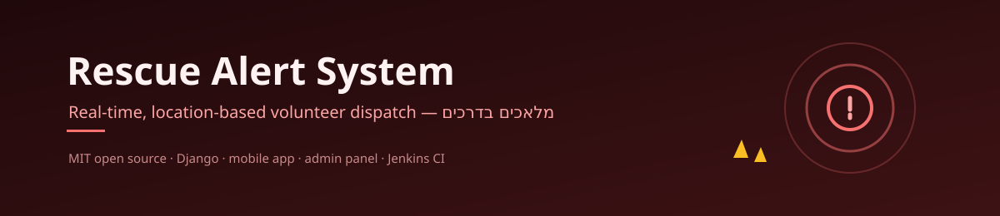
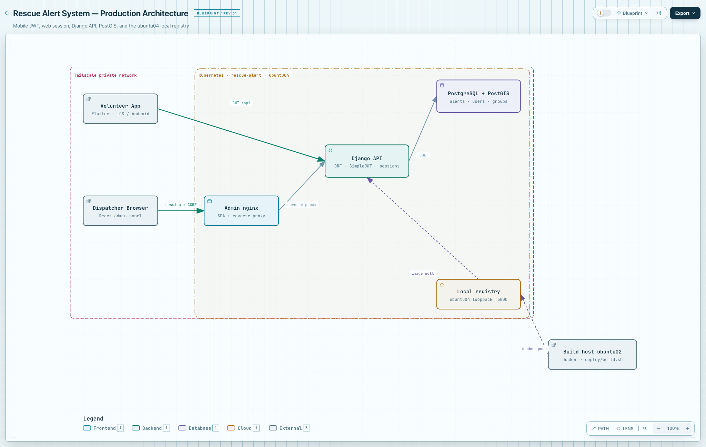
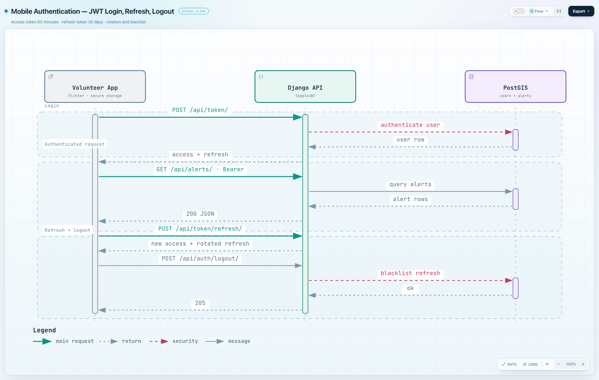
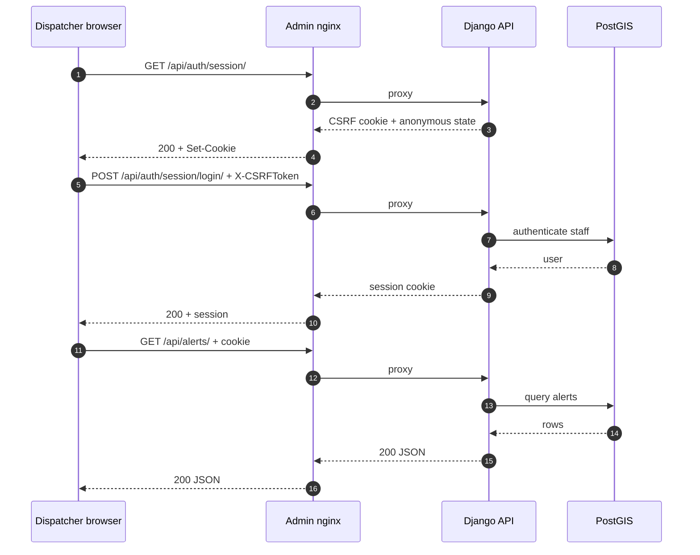
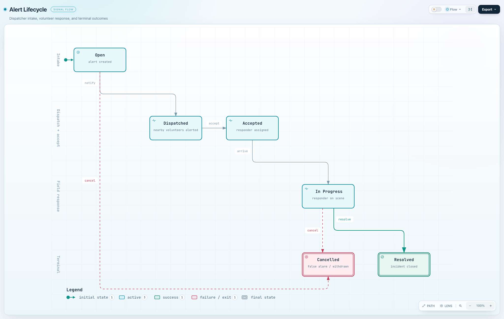
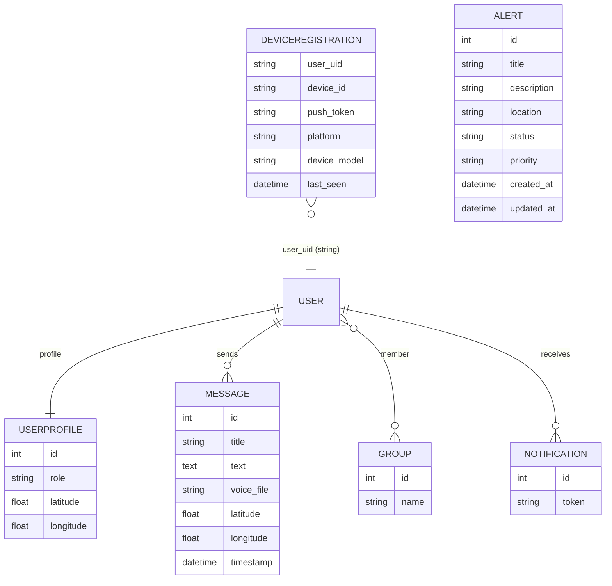
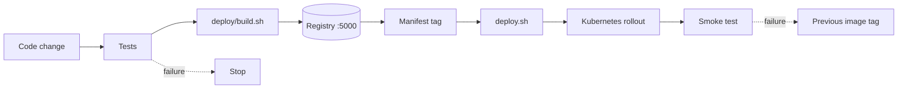

<p align="center"></p>

<h1>🚑 rescue-alert-system</h1>

<p>
A real-time, location-based volunteer alert system for emergency response.
Built as an <strong>MIT open-source project</strong> for Malachim Badrachim (מלאכים בדרכים), a volunteer initiative focused on helping people in urgent situations on the road and beyond.
</p>

<p>
<strong>Anyone is welcome to clone, use, fork, or adapt this project</strong> to build their own rescue alert system.
</p>

<p>
<strong>Project story:</strong> <a href="https://simonhost.navonsimon.com/blog/building-rescue-alert-system">Architecture and product case study</a> ·
<strong>More work:</strong> <a href="https://simonhost.navonsimon.com/work">16 production projects</a>
</p>

<p>
<strong>Developer handoff:</strong> <a href="#developer-handoff">architecture, deployment, auth, runbook, and roadmap</a>.
</p>


<hr>

<h2>🚨 Overview</h2>

<p>
When an incident occurs, the system identifies nearby available volunteers and alerts them in real time so they can respond quickly and efficiently.
</p>

<hr>

<h2>⚙️ Core Features</h2>

<ul>
  <li>Volunteer registration and availability status</li>
  <li>Real-time or recent location tracking</li>
  <li>Incident creation by dispatcher/admin</li>
  <li>Radius-based volunteer matching</li>
  <li>Push notifications to nearby responders (planned; currently disabled)</li>
  <li>Accept / decline response flow</li>
  <li>Responder tracking and coordination</li>
</ul>

<hr>

<h2>🧠 How It Works</h2>

<ol>
  <li>A dispatcher creates an alert with a location</li>
  <li>The system finds nearby available volunteers</li>
  <li>Alerts are available to dispatchers and API clients; push delivery is planned</li>
  <li>Volunteers can accept or decline the alert</li>
  <li>Responders are tracked and coordinated by the system</li>
</ol>

<hr>

<h2>🛠 Tech Stack</h2>

<ul>
  <li><strong>Backend:</strong> Django + Django REST Framework</li>
  <li><strong>Database:</strong> PostgreSQL + PostGIS</li>
  <li><strong>Admin Panel:</strong> React 19 + TypeScript + Vite (web dispatcher dashboard)</li>
  <li><strong>Mobile App:</strong> Flutter</li>
  <li><strong>Authentication:</strong> Django users + JWT (SimpleJWT); session cookies for the web panel</li>
  <li><strong>Notifications:</strong> in-app records; push delivery is pending a self-hosted ntfy/UnifiedPush setup</li>
  <li><strong>Infrastructure:</strong> Docker Compose locally; Kubernetes on the deployment cluster</li>
</ul>

<hr>

<h2>🚀 Getting Started</h2>

<p>
The project is containerized with Docker to make local setup simpler and more consistent across development environments.
</p>

<h3>Prerequisites</h3>
<ul>
  <li>Git</li>
  <li>Docker</li>
  <li>Docker Compose</li>
</ul>

<h3>Local Setup</h3>

<pre>
git clone https://github.com/ShimonNavon/rescue-alert-system.git
cd rescue-alert-system
cp .env.example .env
docker compose --profile dev up --build
</pre>

<p>
The <code>dev</code> profile adds the Vite dev server for the admin panel. Without it (<code>docker compose up --build</code>) only the backend and database start — which is how production runs, since nginx serves the built panel there.
</p>

<h3>Run Migrations</h3>

<p>The container entrypoint already runs <code>migrate</code> and <code>collectstatic</code> on every start. To run them by hand:</p>

<pre>
docker compose exec backend python manage.py migrate
</pre>

<h3>Service URLs</h3>

<ul>
  <li><strong>Backend API:</strong> <code>http://127.0.0.1:8004</code> (gunicorn on port 8000 inside the container)</li>
  <li><strong>Admin Panel:</strong> <code>http://localhost:5173</code> (<code>dev</code> profile only)</li>
  <li><strong>API docs:</strong> <code>http://127.0.0.1:8004/api/docs/</code></li>
</ul>

<hr>

<h2>🧪 Testing</h2>

<p>Run the admin-panel tests/build, mobile analysis/tests, and the live smoke test:</p>

<pre>
./scripts/test_all.sh
</pre>

<p>
Backend tests need Docker and a PostGIS database; run them with
<code>./scripts/test_backend.sh</code> on a Docker host. The live smoke test targets
<code>http://ubuntu03:30093</code> by default; override it with <code>BASE_URL</code>.
</p>

<hr>

<h2>🖥 Admin Panel</h2>

<p>
The <code>admin-panel/</code> folder contains a React + TypeScript web dashboard for dispatchers and operators. It connects to the same Django API and provides views for managing alerts, monitoring volunteer locations on a map, group messaging, and push-to-talk.
</p>

<h3>Run standalone</h3>

<pre>
cd admin-panel
npm install
cp .env.example .env
npm run dev
</pre>

<p>Available at <code>http://localhost:5173</code>. See <a href="admin-panel/README.md">admin-panel/README.md</a> for full documentation.</p>

<h3>Run with Docker Compose</h3>

<p>The admin panel lives behind the <code>dev</code> profile: <code>docker compose --profile dev up --build</code>.</p>

<hr>

<h2 id="developer-handoff">🧭 Developer Handoff</h2>

<p>
This section is the operational and engineering handoff for the Django/React/Flutter
Rescue Alert System. It covers the live architecture, authentication model, deployment
workflow, testing, operations, troubleshooting, known limitations, and the roadmap.
No secrets are in this handoff; live credentials are in the gitignored
<code>deploy/.env.deploy</code>.
</p>

<p>
<strong>Visuals in this handoff:</strong> Archify architecture, JWT sequence, and alert
lifecycle; Mermaid session flow, ER model, and deployment pipeline.
</p>

<ul>
  <li><a href="#1-status-snapshot">1. Status snapshot</a></li>
  <li><a href="#2-architecture">2. Architecture</a></li>
  <li><a href="#3-repository-map">3. Repository map</a></li>
  <li><a href="#4-authentication-and-permissions">4. Authentication and permissions</a></li>
  <li><a href="#5-api-overview">5. API overview</a></li>
  <li><a href="#6-local-development">6. Local development</a></li>
  <li><a href="#7-kubernetes-deployment">7. Kubernetes deployment</a></li>
  <li><a href="#8-configuration-reference">8. Configuration reference</a></li>
  <li><a href="#9-testing">9. Testing</a></li>
  <li><a href="#10-operations-runbook">10. Operations runbook</a></li>
  <li><a href="#11-troubleshooting">11. Troubleshooting</a></li>
  <li><a href="#12-known-limitations-and-technical-debt">12. Known limitations and technical debt</a></li>
  <li><a href="#13-recommended-roadmap">13. Recommended roadmap</a></li>
  <li><a href="#14-handoff-checklist">14. Handoff checklist</a></li>
</ul>

### 1. Status snapshot

| Item | Value |
|---|---|
| Branch | `feat/django-auth-cluster-deploy` |
| Default branch | `main` — **not yet updated** |
| Live panel | `http://ubuntu03:30093/` |
| API docs | `http://ubuntu03:30093/api/docs/` |
| Token helper | `http://ubuntu03:30093/get-token.html` |
| Django admin | `http://ubuntu03:30093/admin/` |
| Namespace | `rescue-alert` |
| NodePort | `30093` |
| Backend image | `localhost:5000/ral-backend:k8s-20261019-0957-final` |
| Admin image | `localhost:5000/ral-admin:k8s-20261019-1016-panel` |
| Backend tests | 11 passing |
| Admin tests | 6 passing |
| Mobile tests | 5 passing |
| Live smoke checks | 16 passing |

#### What works end to end

- Email/password registration with invite code.
- JWT login, refresh, logout/blacklist, and `whoami`.
- Session-cookie login for the web dispatcher panel.
- Staff-only access to the web panel.
- Alerts table, user/situation table, geography map, and alerts modal read live API data.
- PostGIS persistence, migrations, and Django admin.
- Kubernetes deployment, registry push, and smoke-tested rollout.

#### What is intentionally unfinished

- Push notifications are disabled until FCM is replaced with ntfy/UnifiedPush.
- The admin “new event” modal does not create alerts yet.
- Admin chat and push-to-talk views are still mock UI.
- No Android APK has been built (Android SDK is absent on the current build machine).
- No TLS/ingress; the deployment is HTTP over Tailscale.
- No CI pipeline; tests are run manually.
- No SMTP/password-reset email; resets are manual through Django admin.
- No automated database backups.

---

### 2. Architecture

<p align="center">
  <a href="docs/diagrams/system-architecture.html">
    
  </a>
</p>

<p align="center"><em>Interactive Archify diagram:
<a href="docs/diagrams/system-architecture.html">system-architecture.html</a> ·
source <a href="docs/diagrams/system-architecture.architecture.json">JSON</a>.
Open the HTML locally to pan, zoom, inspect paths, and export.</em></p>

#### Runtime topology

- **Control plane:** `ubuntu03` (`kubeadm`, `kubectl`).
- **Worker:** `ubuntu04`. The local registry and the app pods live there.
- **Build host:** `ubuntu02` (Docker); it is not a Kubernetes node.
- **Registry:** `registry:3` on `ubuntu04`, bound to `127.0.0.1:5000`.
  Builds reach it through an SSH tunnel (`~/.ssh/mr-registry`, local port `15000`).
- **Storage:** `local-path` provisioner; PostgreSQL uses a 5 Gi PVC.
- **Ingress:** none. The admin pod’s nginx is the only public entry point.

#### Why the app pods are pinned to `ubuntu04`

The registry listens on `ubuntu04`’s loopback only. Pods therefore pull
`localhost:5000/...` from that node and must be scheduled there. This is enforced with
`nodeSelector: kubernetes.io/hostname: ubuntu04` on the database, backend, and admin
deployments. Moving to a shared registry or image mirror removes this constraint.

---

### 3. Repository map

| Path | Purpose |
|---|---|
| `backend/` | Django 6 + DRF + GeoDjango API |
| `backend/config/` | Settings, URLs, WSGI/ASGI |
| `backend/alerts/` | Models, serializers, views, auth endpoints, tests, migrations |
| `admin-panel/` | React 19 + TypeScript + Vite dispatcher dashboard |
| `mobile/` | Flutter volunteer app |
| `deploy/` | Kubernetes manifest, deploy/build scripts, env template |
| `scripts/` | Test runners and live smoke test |
| `get-token.html` | Same-origin JWT helper for Postman/API testing |
| `postman/` | Postman collection and docs |
| `README.md` | Project overview, setup, testing, and this handoff |

#### Important files

- `backend/config/settings.py` — auth classes, SimpleJWT, CORS/CSRF, invite code.
- `backend/alerts/urls.py` — complete API route map.
- `backend/alerts/views.py` — auth views, device registration, alerts/users/groups API.
- `backend/alerts/serializers.py` — registration, session login, profiles, alerts.
- `backend/alerts/models.py` — `Alert` (PostGIS point), `UserProfile`, `DeviceRegistration`.
- `backend/alerts/tests.py` — backend auth/API suite.
- `admin-panel/src/context/AuthContext.tsx` — session login/CSRF logic.
- `admin-panel/src/services/alertsService.ts` — alerts API client.
- `admin-panel/src/services/usersService.ts` — user profiles API client.
- `mobile/lib/domain/services/auth_service.dart` — JWT auth state.
- `mobile/lib/domain/services/api/rest_api_service.dart` — Dio client and 401 refresh.
- `deploy/k8s/rescue-alert.yaml` — namespace, PVC, DB, backend, admin, NodePort.
- `deploy/build.sh` — build/push images and update manifest tags.
- `deploy/deploy.sh` — apply secret + manifest and wait for rollout.

---

### 4. Authentication and permissions

#### Two auth paths

**Mobile / API clients — JWT**

| Endpoint | Method | Purpose |
|---|---|---|
| `/api/auth/register/` | POST | Create account; requires `invite_code` when configured |
| `/api/token/` | POST | Login with `username` (email or username) + password |
| `/api/token/refresh/` | POST | Rotate refresh token and issue a new access token |
| `/api/auth/logout/` | POST | Blacklist the supplied refresh token |
| `/api/auth/whoami/` | GET | Return the authenticated user |

- Access token: **60 minutes**.
- Refresh token: **30 days**.
- Refresh rotation and blacklist-after-rotation are enabled.
- Registration sets `username = email` (lowercased) and creates the profile via signal.
- Login accepts either the username or the email address.

<p align="center">
  <a href="docs/diagrams/auth-jwt.sequence.html">
    
  </a>
</p>

<p align="center"><em>Interactive Archify sequence:
<a href="docs/diagrams/auth-jwt.sequence.html">auth-jwt.sequence.html</a> ·
source <a href="docs/diagrams/auth-jwt.sequence.json">JSON</a>.</em></p>

**Web panel — session cookie**

| Endpoint | Method | Purpose |
|---|---|---|
| `/api/auth/session/` | GET | Current session state; also sets the CSRF cookie |
| `/api/auth/session/login/` | POST | Staff-only session login |
| `/api/auth/session/logout/` | POST | Close the session |

- Cookie auth is `SessionAuthentication`; unsafe requests require `X-CSRFToken`.
- The panel calls `GET /api/auth/session/` on load, then sends the CSRF cookie value
  with login/logout POSTs.
- `SESSION_COOKIE_SECURE` and `CSRF_COOKIE_SECURE` are `False` in the current cluster
  because the edge is HTTP. Set them to `True` when TLS is added.

<p><strong>Web session flow</strong></p>



#### Roles and permissions

- DRF default permission is `IsAuthenticated`; **every authenticated user can read and
  write alerts, users, groups, messages, and notifications** unless a view overrides it.
- `is_staff` gates the web dispatcher panel only.
- `UserProfile.role` is informational today (`user`, `rescuer`, `admin`); it is not yet
  enforced by API permissions.
- The invite code is a shared registration gate, not per-user provisioning.

#### Password reset

Not implemented by email. An administrator can reset a password with:

```bash
kubectl -n rescue-alert exec -it deploy/backend -- python manage.py changepassword <username>
```

---

### 5. API overview

All routes are under `/api/`. Interactive docs: `/api/docs/`; schema: `/api/schema/`.

#### Alerts

| Endpoint | Methods | Notes |
|---|---|---|
| `/api/alerts/` | GET, POST | List/create; serializer accepts `latitude`/`longitude` |
| `/api/alerts/{id}/` | GET, PUT, PATCH, DELETE | Standard DRF detail |
| `/api/alerts/nearby/?lat=&lon=&radius=` | GET | Radius filter in metres |

Alert statuses: `OPEN`, `DISPATCHED`, `ACCEPTED`, `IN_PROGRESS`, `RESOLVED`, `CANCELLED`.
Priorities: `LOW`, `MEDIUM`, `HIGH`, `CRITICAL`. Location is stored as a PostGIS point.

<p align="center">
  <a href="docs/diagrams/alert-lifecycle.lifecycle.html">
    
  </a>
</p>

<p align="center"><em>Interactive Archify lifecycle:
<a href="docs/diagrams/alert-lifecycle.lifecycle.html">alert-lifecycle.lifecycle.html</a> ·
source <a href="docs/diagrams/alert-lifecycle.lifecycle.json">JSON</a>.</em></p>

<p><strong>Data model</strong></p>



#### Users

| Endpoint | Methods | Notes |
|---|---|---|
| `/api/user/` | GET, POST | User profiles (used by the admin situation table) |
| `/api/user/{id}/` | GET, PUT, PATCH, DELETE | Profile detail |
| `/api/user/all/` | GET | Only profiles with coordinates |
| `/api/user/location/` | POST | Update own lat/lon |
| `/api/user/profile/` | GET | Current user profile |
| `/api/user/update_profile/` | PUT | Update own profile |

#### Groups, messages, notifications

- `/api/group/` and `/api/group/{id}/` — groups with member user IDs.
- `/api/group/{id}/add_user/` and `remove_user/` — membership actions.
- `/api/message/` — in-app messages; sender is set from the authenticated user.
- `/api/message/list_messages/` — newest first.
- `/api/notification/` — legacy notification token records.
- `/api/notifications/token` and `/api/notifications/token/` — device registration
  (`push_token`, `device_id`, `platform`, `device_model`); stores `user_uid` from the
  authenticated user. The push sender is not implemented.

#### Pagination and rate limiting

- No pagination is configured; list endpoints return all rows.
- No API throttling is configured. Add DRF throttling and a shared cache before a
  public launch, especially for login/registration.

---

### 6. Local development

#### Prerequisites

- Git
- Docker + Docker Compose
- Node.js 20+ (admin panel)
- Flutter 3.47+ / Dart 3.13+ (mobile)
- Android SDK or Xcode/CocoaPods for device builds

#### Backend + database + admin (Docker Compose)

```bash
git clone https://github.com/ShimonNavon/rescue-alert-system.git
cd rescue-alert-system
git checkout feat/django-auth-cluster-deploy
cp .env.example .env
docker compose --profile dev up --build
```

- Backend: `http://127.0.0.1:8004`
- Admin panel (Vite dev server): `http://localhost:5173`
- API docs: `http://127.0.0.1:8004/api/docs/`

The backend entrypoint waits for PostgreSQL, runs `migrate`, runs `collectstatic`, and
starts gunicorn.

Create a staff user for the panel:

```bash
docker compose exec backend python manage.py createsuperuser
```

Optional demo data:

```bash
docker compose exec backend python manage.py populate_mock_data
```

Demo users (`rescuer1` … `user3`) use password `test123`. They are **not staff** and
cannot access the web panel; remove or disable them for production.

#### Admin panel standalone

```bash
cd admin-panel
npm install
npm run dev
```

`.env.development` points at `http://localhost:8004/api/`. The backend’s dev settings
trust the Vite origins and allow credentialed CORS.

Useful commands:

```bash
npm test          # Vitest component tests
npm run build     # type-check + production build
npm run lint      # ESLint (currently not part of the handoff gate)
```

#### Mobile

```bash
cd mobile
flutter pub get
flutter run --dart-define=ENV=staging
```

- `.env.staging` and `.env.production` are committed; both point at
  `http://ubuntu03:30093` and contain no secrets.
- Set `MAPBOX_ACCESS_TOKEN` to enable the map.
- Auth is JWT against the Django API; sign-up requires the server invite code.
- Push notifications are a no-op stub until ntfy/UnifiedPush is added.

Tests:

```bash
flutter analyze --no-fatal-infos --no-fatal-warnings
flutter test
```

---

### 7. Kubernetes deployment

#### Manifests

`deploy/k8s/rescue-alert.yaml` creates:

- Namespace `rescue-alert`
- PVC `postgres-data` (5 Gi, `local-path`)
- `db` Deployment + Service (`postgis/postgis:17-3.5`)
- `backend` Deployment + Service (ClusterIP `:8000`)
- `admin` Deployment + Service (NodePort `30093`)
- All three app deployments pinned to `ubuntu04`

The admin pod’s nginx serves the built Vite app and proxies `/api/`, `/admin/`,
`/static/`, and `/media/` to `backend:8000`.

Backend probes use `GET /api/docs/` with `Host: ubuntu03`. If the cluster hostname
changes, update both the probe header and `ALLOWED_HOSTS`/`CSRF_TRUSTED_ORIGINS`.

<p><strong>Deployment pipeline</strong></p>



#### Build and push

On the Docker host (`ubuntu02`) with the registry tunnel key:

```bash
cd ~/ral-handoff   # or any clone of the branch
./deploy/build.sh <tag>          # build both images
PUSH=1 ./deploy/build.sh <tag>   # build, push, and update manifest tags
```

Environment overrides for the push step:

```bash
REGISTRY_USER=simon
REGISTRY_HOST=ubuntu04
REGISTRY_KEY=~/.ssh/mr-registry
REGISTRY_LOCAL_PORT=15000
```

`PUSH=1` tags and pushes to `localhost:15000/ral-backend:<tag>` and
`localhost:15000/ral-admin:<tag>`, then rewrites the image tags in the manifest.

#### Apply

```bash
cp deploy/.env.example deploy/.env.deploy   # fill in real values; do this once
./deploy/deploy.sh
```

`deploy/deploy.sh`:

1. Creates/updates the namespace.
2. Creates/updates the `rescue-alert-env` Secret from `deploy/.env.deploy`.
3. Removes the retired Firebase key if it still exists.
4. Applies the manifest.
5. Waits for DB, backend, and admin rollouts.

It assumes `ssh ubuntu03` works and that `kubectl` is on that host. It does **not**
build images; run `deploy/build.sh` first when code changes.

#### Post-deploy

Migrations run automatically in the backend entrypoint. To seed demo data:

```bash
kubectl -n rescue-alert exec deploy/backend -- python manage.py populate_mock_data
```

To create a staff user:

```bash
kubectl -n rescue-alert exec -it deploy/backend -- python manage.py createsuperuser
```

---

### 8. Configuration reference

#### Root `.env` (local Docker Compose)

| Variable | Purpose |
|---|---|
| `POSTGRES_DB`, `POSTGRES_USER`, `POSTGRES_PASSWORD` | Database credentials |
| `POSTGRES_HOST`, `POSTGRES_PORT` | Compose DB connection (`db:5432`) |
| `SECRET_KEY` | Django secret; must be long and private |
| `DEBUG` | `True` locally, `False` in the cluster |
| `ALLOWED_HOSTS` | Comma-separated hostnames |
| `CORS_ALLOWED_ORIGINS` | Dev origins for the Vite panel |
| `CSRF_TRUSTED_ORIGINS` | Optional override; dev localhost origins are added automatically |
| `SESSION_COOKIE_SECURE`, `CSRF_COOKIE_SECURE` | Force secure cookies when using HTTP(S) |
| `REGISTRATION_INVITE_CODE` | Required for new registrations when set; empty allows open signup |

#### `deploy/.env.deploy` (cluster Secret)

| Key | Purpose |
|---|---|
| `SECRET_KEY` | Django secret |
| `POSTGRES_PASSWORD` | PostgreSQL password |
| `DJANGO_SUPERUSER_USERNAME`, `DJANGO_SUPERUSER_EMAIL`, `DJANGO_SUPERUSER_PASSWORD` | Initial staff account |
| `DEBUG` | `False` |
| `ALLOWED_HOSTS` | `ubuntu03`, `ubuntu04`, node IPs, Tailscale IPs, localhost |
| `CSRF_TRUSTED_ORIGINS` | HTTP origins including `:30093` |
| `SESSION_COOKIE_SECURE`, `CSRF_COOKIE_SECURE` | `False` for the HTTP edge |
| `REGISTRATION_INVITE_CODE` | Shared registration gate |

**Important:** changing `POSTGRES_PASSWORD` in the Secret does not change the password
already stored inside PostgreSQL. Rotate the database password first, then update the
Secret and restart the backend. Preserve `deploy/.env.deploy` or retrieve the values from
the Kubernetes Secret before rotating anything.

#### Admin panel

- `.env.production`: `VITE_API_BASE_URL=/api/` (same-origin behind nginx).
- `.env.development`: `VITE_API_BASE_URL=http://localhost:8004/api/`.
- The Docker build also sets `VITE_API_BASE_URL=/api/`.

#### Mobile

- `.env.staging` / `.env.production`: `ENV`, `API_BASE_URL`, `MAPBOX_ACCESS_TOKEN`.
- Committed values use the Tailscale host `http://ubuntu03:30093`.
- Change `API_BASE_URL` for another environment.

---

### 9. Testing

#### One command

```bash
./scripts/test_all.sh
```

Runs admin tests/build, mobile analysis/tests, backend tests if Docker is available, and
the live smoke test.

#### Backend

```bash
./scripts/test_backend.sh
```

Builds the backend image, starts an ephemeral PostGIS 17/3.5 container, runs
`manage.py check`, and runs all 11 tests. Requires Docker. It cleans up the test
database/network/image afterward.

Coverage includes:

- Registration with invite code and duplicate-email rejection.
- JWT login with email, refresh, logout/blacklist.
- `whoami` and alert authentication.
- Device registration binding to the authenticated user.
- Session login/logout and staff-only panel access.

#### Admin panel

```bash
cd admin-panel
npm ci
npm test
npm run build
```

Current tests cover login submission/error display, live alert-row rendering, and
live user-profile rendering (6 tests).

#### Mobile

```bash
cd mobile
flutter pub get
flutter analyze --no-fatal-infos --no-fatal-warnings
flutter test
```

Current tests cover `AuthUser` parsing, JWT model parsing, env fallback, and bottom-tab
navigation (5 tests).

#### Live smoke test

```bash
python3 scripts/smoke_test.py
# or
BASE_URL=http://ubuntu03:30093 python3 scripts/smoke_test.py
```

It reads admin credentials from `deploy/.env.deploy`; alternatively set
`SMOKE_ADMIN_USER` and `SMOKE_ADMIN_PASSWORD`. Checks include:

- Public pages and API docs.
- Unauthenticated alerts return 401.
- Seeded volunteer JWT login, whoami, alerts, refresh.
- Admin session login/current-user/alerts/users/logout.
- Volunteer panel login rejection.

No test users are created; the live smoke test is read-only.

---

### 10. Operations runbook

#### Inspect status

```bash
ssh ubuntu03
kubectl -n rescue-alert get pods -o wide
kubectl -n rescue-alert get deploy,svc,pvc
kubectl -n rescue-alert logs deploy/backend --tail=100
kubectl -n rescue-alert logs deploy/admin --tail=100
```

#### Restart a deployment

```bash
kubectl -n rescue-alert rollout restart deploy/backend
kubectl -n rescue-alert rollout status deploy/backend --timeout=300s
```

Restarting the DB is safe for the PVC, but the backend may briefly return errors while
PostgreSQL restarts.

#### Redeploy after a code change

```bash
# On ubuntu02, in a clone of the branch
PUSH=1 ./deploy/build.sh <new-tag>

# On a machine with kubectl access
./deploy/deploy.sh
```

#### Roll back an image

Edit the image tag in `deploy/k8s/rescue-alert.yaml` to the previous tag and run:

```bash
kubectl apply -f deploy/k8s/rescue-alert.yaml
kubectl -n rescue-alert rollout status deploy/backend
```

or use `kubectl rollout undo deployment/backend -n rescue-alert` if the Deployment
revision history is intact.

#### Rotate the invite code

1. Update `REGISTRATION_INVITE_CODE` in `deploy/.env.deploy`.
2. Run `./deploy/deploy.sh`.
3. Restart the backend so the new environment is loaded:
   `kubectl -n rescue-alert rollout restart deploy/backend`.

#### Database backup (manual)

There is no automated backup. Example:

```bash
kubectl -n rescue-alert exec db-<pod> -- \
  pg_dump -U rescue_user rescue_alert | gzip > rescue_alert-$(date +%F).sql.gz
```

Restore is the reverse with `gunzip -c ... | kubectl exec -i ... -- psql -U rescue_user -d rescue_alert`.
Test restores in a disposable namespace before relying on them.

#### Credentials

```bash
# superuser password
grep '^DJANGO_SUPERUSER_PASSWORD=' deploy/.env.deploy

# invite code
grep '^REGISTRATION_INVITE_CODE=' deploy/.env.deploy

# in-cluster values
kubectl -n rescue-alert get secret rescue-alert-env -o jsonpath='{.data}' | ...
```

Do not commit `.env.deploy` or paste its contents into tickets/chat.

---

### 11. Troubleshooting

| Symptom | Likely cause | Fix |
|---|---|---|
| Probe returns 400 `DisallowedHost` | Probe sends pod IP as `Host` | Keep the `Host: ubuntu03` header in the probes or add the host to `ALLOWED_HOSTS` |
| 403 CSRF on panel login | Missing/expired CSRF cookie, or origin not trusted | Load `GET /api/auth/session/`, then send `X-CSRFToken`; add the origin to `CSRF_TRUSTED_ORIGINS` |
| 401 on API calls | Missing/expired JWT | Login again; refresh with a valid refresh token; check token blacklist after logout |
| 502 from admin nginx | Backend not ready / DNS/Service issue | Check backend pod, logs, Service endpoints, and `backend:8000` resolution |
| `ImagePullBackOff` | Registry tunnel down, wrong tag, or pod scheduled off `ubuntu04` | Start the tunnel, verify the tag in the registry, check the nodeSelector |
| DB authentication failed | Secret password differs from the initialized DB password | Use the original password or rotate the DB password and Secret together |
| Migrations fail on startup | Schema/migration mismatch | Inspect backend logs; back up the DB before changing migrations |
| Pods pending | Node selector, PVC node affinity, or resources | Check `kubectl describe pod`; the PVC is bound to `ubuntu04` |
| Panel shows “שגיאה” on data views | Session expired or API unavailable | Re-login; check `/api/alerts/` and `/api/user/` with the session cookie |
| Deleting PVC loses data | `local-path` reclaim policy is `Delete` | Back up before deleting the PVC/namespace |

---

### 12. Known limitations and technical debt

#### Functional

- Push notifications are not delivered. `NotificationService` is a stub; FCM was removed.
- Admin “new event” modal is not wired to `POST /api/alerts/`.
- Admin chat and push-to-talk views are mock.
- Password resets are manual; no SMTP or reset-token flow.
- The mobile app has no background alert delivery; it relies on in-app refresh.
- No user deactivation/approval workflow; anyone with the invite code can register.

#### Security and operations

- HTTP only over Tailscale. Do not expose NodePort `30093` publicly without TLS and
  authentication hardening.
- Android uses `usesCleartextTraffic="true"` for the Tailscale URL.
- Any authenticated API user can read all alerts/users/groups/messages; role-based
  authorization is not enforced.
- The invite code is shared, not single-use.
- Demo users with password `test123` exist in the current database.
- No rate limiting, account lockout, or MFA.
- No automated backups or disaster-recovery runbook beyond the manual `pg_dump` example.
- No CI/CD; deployments are manual scripts over SSH.
- No observability beyond Kubernetes logs and the existing monitoring stack.
- Database password rotation requires coordinated DB/Secret changes.
- The local registry/node pin creates a single-node dependency.
- `main` is still the old code; the branch must be merged or used explicitly.

#### Mobile

- Android SDK is not installed on the build host; no APK has been produced.
- iOS needs Xcode/CocoaPods; ATS blocks plain HTTP by default.
- Mapbox token is empty in the committed env files.

---

### 13. Recommended roadmap

Priority order for the next developer:

1. **Merge the branch** into `main` (or open a PR from
   `feat/django-auth-cluster-deploy`).
2. **Add ntfy/UnifiedPush** and replace the `NotificationService` stub; wire backend
   alert → push publishing.
3. **Add TLS/ingress** and set `SESSION_COOKIE_SECURE=True`,
   `CSRF_COOKIE_SECURE=True`, `SECURE_SSL_REDIRECT=True`, and HSTS after verifying the
   proxy forwards `X-Forwarded-Proto`.
4. **Build and test the mobile app** on a real Android device; add an iOS build path and
   ATS policy.
5. **Wire the “new event” modal** to `createAlert` and add dispatcher workflows
   (assign/accept/resolve).
6. **Add role-based permissions** (dispatcher/admin/rescuer/user) and rate limiting for
   auth endpoints.
7. **Add CI** (GitHub Actions): backend tests with a PostGIS service, admin tests/build,
   Flutter analyze/test.
8. **Add SMTP + password reset** or an admin-invite onboarding flow.
9. **Add automated backups** for PostgreSQL and a restore drill.
10. **Replace the single-node local registry** with a shared registry or image mirror,
    then remove the `ubuntu04` node pin.

---

### 14. Handoff checklist

#### For the current owner (Simon)

- [ ] Merge `feat/django-auth-cluster-deploy` into `main`, or open a PR for review.
- [ ] Share `deploy/.env.deploy` through a secure channel.
- [ ] Grant the developer Tailscale access to `ubuntu03:30093`.
- [ ] Grant SSH access to `ubuntu03` (kubectl), `ubuntu02` (Docker), and the
      `~/.ssh/mr-registry` key for `ubuntu04`.
- [ ] Decide whether push (ntfy), TLS, and CI are part of the first sprint.
- [ ] Confirm the demo users/invite code are acceptable in the target environment.

#### For the receiving developer

- [ ] Clone the branch and run `./scripts/test_all.sh`.
- [ ] Run `./scripts/test_backend.sh` on a Docker host.
- [ ] Read sections 4, 7, and 10 before changing auth or deployment.
- [ ] Confirm `deploy/.env.deploy` and cluster access are available.
- [ ] Never commit secrets; `.env.deploy`, real service-account keys, and
      `google-services.json` are gitignored.
- [ ] Run `python3 scripts/smoke_test.py` after every deploy.
- [ ] Check `kubectl -n rescue-alert get pods` and backend logs after rollout.

---

### Live access summary

- Admin panel: `http://ubuntu03:30093/` (staff only)
- Tailscale IP: `http://100.119.17.32:30093/`
- API docs: `http://ubuntu03:30093/api/docs/`
- Token helper: `http://ubuntu03:30093/get-token.html`
- Django admin: `http://ubuntu03:30093/admin/`
- GitHub branch: `feat/django-auth-cluster-deploy`

<h2>🤝 Contributing</h2>

<p>
Contributions are welcome. If you want to improve the system, fix bugs, add features, or adapt it for your own organization, feel free to open an issue or submit a pull request.
</p>

<p>
There is also a WhatsApp group for active developers who want to help build the project.
</p>

<hr>

<h2>📚 Documentation</h2>

<p>
For deeper technical and project documentation, see the project Wiki.
</p>

<hr>

<h2>📄 License</h2>

<p>
This project is licensed under the MIT License.
</p>
<!-- test webhook -->
